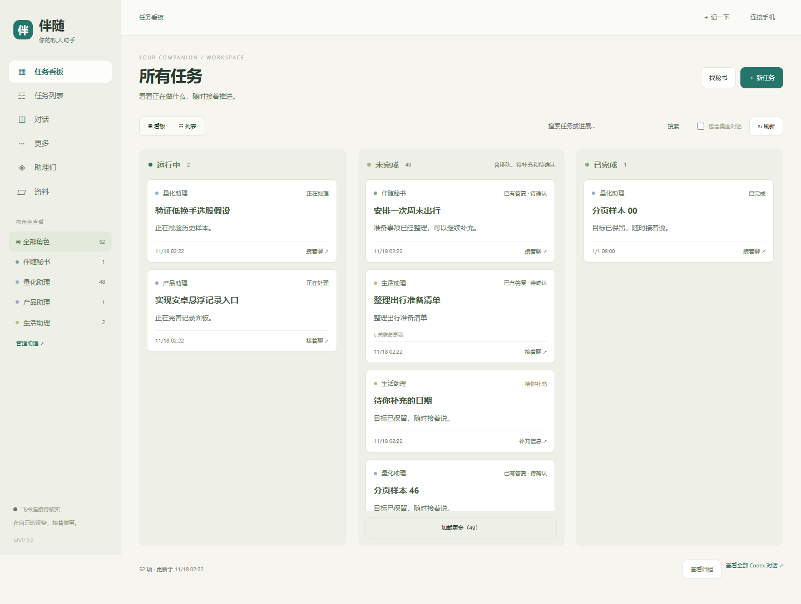

# 伴随 · Companion Shell

给 Codex Desktop 一个贴近生活的壳：飞书上交代事情，电脑上看任务进展，手机上随手记。默认一位秘书，有稳定的专业需要时再招募独立助理。

MIT 开源，本机运行，无需租用服务器。当前版本 **MVP 0.2.0**，以 Windows + Codex Desktop 为主机。



## 这一版能做什么

- **任务大盘**：运行中、未完成、已完成；按角色筛选、搜索、看板/列表、独立分页。模型回答结束后仍待你确认，补充要求会重新打开同一任务。
- **秘书与专业助理**：同一任务可以直接找负责人，也能请秘书汇总；每个角色使用独立的 Codex 原生会话。交接带上要求、相关资料、摘要与成果，保留任务编号。
- **飞书原生交互**：任务卡、补充表单、记录表单、资料回执、招募与交接清单；持久化接收操作、快速回执、异步执行。支持菜单配置、独立角色机器人开通和每只机器人的用户绑定。
- **按需组织团队**：秘书可通过工作接口提出招募/精简建议，用户确认后生效。解雇先停止接单，把任务、记忆、技能登记和成果并回秘书，再申请平台停用；平台失败会如实显示待处理。
- **Android 随手记**：小悬浮图标，点开微面板，保存后回到原应用；系统分享文字、链接、图片；本机草稿和离线保存，连接恢复后重试同步。
- **有范围的记忆与资料**：个人、角色、任务、项目记忆可修正和停用；资料主动选入任务。成果保留快照，可预览自包含 HTML；个人资料可导出 ZIP/JSON。

模型登录、推理和实际工具执行交给已安装的官方 Codex Desktop。该项目不要求额外购买模型 API。

## 在 Windows 使用

需要已登录的 Codex Desktop，以及你自己的飞书应用机器人。已有兼容的 Codex 飞书桥接时：

1. 使用 Windows 交付包，运行 **安装伴随.cmd**。源码安装先运行 `npm ci`。
2. 运行 **启动伴随.cmd**，工作台在本机打开，Windows 托盘提供轻记录入口。
3. 在“助理们”中核验飞书菜单与卡片，完成飞书平台要求的账号本人确认和发布。
4. 点“发送连接测试卡”，到飞书点一下，工作台会显示真实回调是否返回。

没有旧桥接的新电脑，先按 [安装与日常使用](docs/安装与日常使用.md) 用 `bridge-kit` 配置底层连接，再安装工作台。当前仍是开发者 MVP，不是一键免配置的消费级安装器。

安装会等待正在执行的工作结束，冷备份程序、配置和数据。个人数据保存在 `%LOCALAPPDATA%\CompanionMVP\data`，程序升级保留数据；撤回工具会检查尚未完成的本地工作与回执。

## 手机入口

安装 [Android APK](dist/companion-capture-0.2.0.apk)。在工作台“连接手机”生成一次性配对信息，粘贴到 APK“连接”页面。配对使用证书指纹，票据十分钟有效且只能用一次。

开启悬浮入口后，点“记”即可留下眼前的一句话；应用支持系统分享图片和链接。记录先落到手机，电脑在线后同步。手机和电脑需要能相互访问，例如同一 Wi-Fi 或已有的 Tailscale 网络。

在飞书私聊秘书，可直接发送 **任务 / 记一下 / 我的助理 / 当前任务 / 招募助理**，也保留 `/新任务`、`/切换`、`/安装包`、`/连接手机` 等兼容命令。专业机器人需要分别绑定用户；不同应用的 open_id 不会混用。

## 验证与开发

```powershell
npm ci
npm ci --prefix bridge-kit
npm run check
npm test
npm run test:bridge
npx playwright install chromium
npm run test:browser
```

浏览器回归使用独立数据库和替身外部适配器；真实 Windows、Codex、飞书和 Android 验收另行记录，不能用页面测试替代。[查看案例与实际证据](docs/验证记录.md)。Android 的构建、测试源应用和模拟器验收步骤见 [Android 构建](docs/Android构建.md)。

## 当前边界与完整方案

这一版是一台 Windows 协调，Android 负责轻记录。跨电脑自动发现、P2P 同步、iOS、自学习记忆、技能训练、统一定时任务页面和其他模型厂商调度保留在后续方案中。

应用只接收主动登记与分享的内容。登记小红书/微信链接不等于抓到正文；没有自动读取微信历史、持续录屏、浏览历史或其他应用数据库。角色隔离是会话、记忆范围和工作接口的逻辑隔离；所有角色仍使用同一台电脑和同一套 Codex 工具权限。

飞书创建应用需要本人确认，发布与停用受平台权限、应用来源和审核约束。提交发布不等于已经上线；内部交接成功也不等于平台机器人已停用。只读对话依赖当前 Codex Desktop 提供的任务通道，桌面版升级后需重新验收。

- [首版范围与路线图](docs/首版范围与路线图.md)
- [完整技术方案](docs/完整技术方案.md)
- [完整产品与页面交互](docs/product/页面与交互流程-从简单助手到专业协作.md)
- [角色、机器人与隔离方案](docs/角色机器人与隔离方案.md)
- [Web / Android 设计稿](docs/界面重设计V2.md)
- [飞书十二屏交互图与可点击原型](docs/feishu-v2/index.html)
- [飞书接入调研](docs/feishu-v2/飞书接入调研.md)

原设计与长期方案完整保留；设计图中的后续功能不等于本版已实现。
