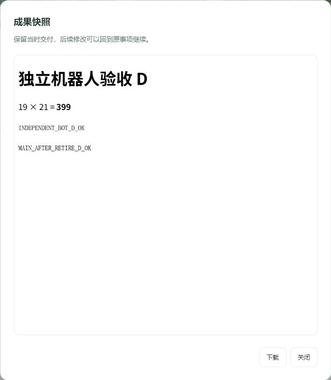

# MVP 0.3.2 独立飞书机器人用户视角补测报告

验收日期：2026-11-20，香港时间。使用本机已安装的伴随工作台、已登录的飞书开发者后台与企业管理后台、飞书 Windows 客户端、官方 Codex Desktop，以及明确标记的合成任务和记忆。

上一版只验证了内部人员招募、任务并回和主机器人链路，把独立平台机器人的开通与停用留作未覆盖项，未满足完整验收要求。本次已实际创建一只独立应用机器人，跑通发布、绑定、真实任务、卡片回调、文件交付、工作交接、平台停用，以及停用后由主助理继续同一任务。

**结论：后台辅助的独立机器人完整生命周期通过。全自动一键开通和通过接口自动停用仍有明确的平台限制，不能称为全部自动化通过。**

## 实际操作与结果

| 用户路径 | 实际结果 | 验证方式 |
| --- | --- | --- |
| 为“飞书验收助理”建立独立入口 | 新建企业自建应用，添加机器人能力；仅申请消息、资源、应用配置所需的 5 项权限 | 在已登录的真实开发者后台创建 |
| 连接这只独立机器人 | 从工作台“飞书连接设置”提交自己的应用编号与密钥；凭据使用 Windows 加密存储 | 实际网页表单、真实身份查询与长连接；未把密钥放进聊天 |
| 配置并发布 | 消息事件、菜单事件、卡片回调用真实配置接口提交，发布版本 0.0.2；后台核实“已发布、已启用” | 真实接口和真实平台状态 |
| 本人绑定 | 在新机器人私聊发送一次绑定消息，收到“已绑定你的独立助理” | 真实 Windows 飞书客户端 |
| 验证入口隔离 | 新应用与主应用身份不同，绑定用户的应用内身份也不同；新机器人“我的任务”为 0，没有列出主助理原有的 5 项任务 | 真实卡片点击、回调和数据库核对 |
| 给新机器人交办任务 D | 19 × 21，生成含 `399` 与 `INDEPENDENT_BOT_D_OK` 的 HTML；进入独立 Codex 会话 | 真实飞书交办与实际模型执行 |
| 验证新机器人交付 | 只收到 1 条目标 HTML 文件消息，361 字节；从飞书下载后与本机成果快照字节一致 | 真实消息与文件下载接口 |
| 让工作并回主助理 | 网页点“并回助理”，只确认一次；任务编号、原专业会话与已有成果保留，合成角色记忆并回助理 | 真实工作台交接与持久化检查 |
| 核实接口停用权限 | 主应用实际没有“启用和停用应用”的租户管理权限；不会把接口未成功写成已停用 | 真实权限接口与实际交接后的待停用状态 |
| 真正停用平台应用 | 企业管理后台对同一验收应用确认停用，显示“已停用”“被企业管理员停用” | 真实后台操作；没有仅靠关闭本机连接充数 |
| 同步本机状态 | 在工作台明确登记已观察到的后台结果；标记为“人工核验记录”，旧连接关闭 | 真实网页提交；与接口验证状态分开 |
| 停用后继续原任务 | 从原看板事项进入助理续聊，要求原 HTML 增加 `MAIN_AFTER_RETIRE_D_OK` | 真实工作台交办、主助理新的 Codex 会话 |
| 验证主助理接管交付 | 原任务编号不变，原会话和旧快照仍在；主飞书机器人回传 1 个更新文件，408 字节，包含原标记、399 和新标记 | 真实客户端、真实下载与内容摘要核对 |
| 验收收尾 | 任务确认完成并归档；验收角色已并回、平台应用已停用；验收合成记忆停用但保留交接来源 | 实际持久化状态 |

## 文件核对

| 文件阶段 | 字节数 | 飞书下载内容 SHA-256 |
| --- | --- | --- |
| 独立机器人首次交付 | 361 | `df7470a88429bc934137382e49bc4070b75e9b40c472c0ddc10a240f2088f9c5` |
| 停用后主助理续接交付 | 408 | `dbba46718da5b69da60722749297d10c3e05ea0715262d0c9c3561b1be152fe3` |

两次都与对应的本机不可变快照一致。原成果没有被覆盖，事项内保留两份快照。[脱敏实际证据](bot-lifecycle-032.json)。

## 补测发现并修复的问题

- **交接后仍向旧机器人回信。** 现在在逐任务交接事务中，将明确属于原应用及其已绑定用户的私人回信目标切换到主助理自己的应用内用户。保留旧目标审计，清除旧应用消息和群话题标识；群聊、其他用户或其他应用的来源不会被擅自迁到个人私聊。
- **执行结束不代表文件已经发完。** 停用前等待原应用已接收的操作、待发消息、附件重试，以及尚未变成飞书转发的本地附件全部排空。并发停用、人工登记和迟到消息也有保护。
- **创建确认可能返回已占用的应用。** 结果属于主机器人、其他角色或不同应用时，在保存新凭据、配置或改动应用之前拒绝，避免串角色。
- **菜单校验失败堵住消息开通。** 本租户完整菜单配置实际返回 210011，最小机器人启用配置成功；现在继续配置消息和卡片，并明确提示菜单需要后台处理。已在真实后台配置菜单，未把未点击验证的菜单标为已验证。
- **已有应用缺少恢复入口。** 工作台增加折叠的连接与继续配置入口；更换应用信息时清除旧应用的验证结果，输入密钥不进入聊天，提交或关闭后清空表单。
- **停用状态和错误不准确。** 缺管理权限明确保留待停用状态；临时平台错误仍可重试；后台人工核验与接口成功使用不同记录。已停用应用在重启后不会自动重连。

## 回归与发布验证

Windows 接入包从新目录解压，使用包内 Node 执行：88 项后端、35 项底层桥接、10 项浏览器交互、6 项 Windows 托盘和 2 项安装回退，共 141 项检查。结果见[交付包检查记录](release-smoke-032.json)。这些自动化使用隔离数据和外部适配器替身；真实后台、飞书、模型和文件下载是上表单独执行的链路。

故障注入覆盖缺管理权限、平台临时错误、停用并发、延迟回调、未来重试中的文件，以及主助理尚未绑定时拒绝部分交接。不能把这些替身故障测试称作真实平台故障。

## 仍然存在的限制

1. **此次是后台辅助创建与停用。** 没有把“SDK 首次创建确认 → 全部配置 → 发布 → 可聊”的整条自动路径标为通过。不同创建渠道的 V7 配置能力仍有限制；绑定后台创建的应用是本次真实成功路径。
2. **成功的管理接口停用没有实测。** 主应用缺少租户管理授权，因此本次采用已登录企业后台实际停用。成功 PUT、重试和并发分支已做替身回归。[官方管理接口](https://open.feishu.cn/document/uAjLw4CM/ukTMukTMukTM/application-v6/application-management/update.md) 要求对应管理权限；[官方权限查询](https://open.feishu.cn/document/uAjLw4CM/ukTMukTMukTM/application-v6/scope/list.md) 用于预检。
3. **新机器人菜单已在后台配置，但客户端菜单点击未验收。** 普通消息、任务、文件和原生卡片点击均已真实验收。
4. Android 本次没有改动，仍为 0.2.0 APK。模拟器日常链路见[0.3.1 报告](0.3.1用户验收报告.md)，实体手机仍待验证。
5. 角色仍是会话、资料与记忆范围的逻辑隔离，共用本机 Windows 和 Codex 工具权限，不是操作系统强隔离。

## 你复测时可直接看哪里

“协作与飞书”里的“飞书验收助理”应显示工作已并回、后台确认停用；主助理继续连接。任务看板打开归档，找到“独立机器人验收D”，可看到两份 HTML 快照。主飞书机器人的最新验收文件应为 408 字节。旧独立机器人保留原聊天历史，但已停止平台使用。

报告、公开图片和 JSON 不包含真实应用编号、绑定码、密钥或私人聊天内容；完整平台截图仅保存在本机验收目录。
