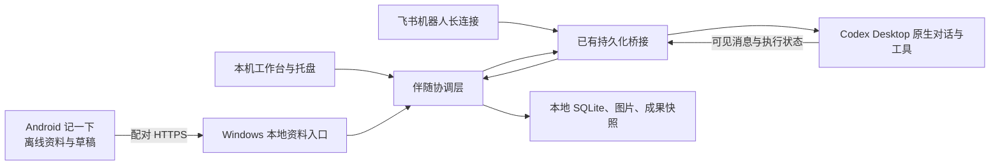
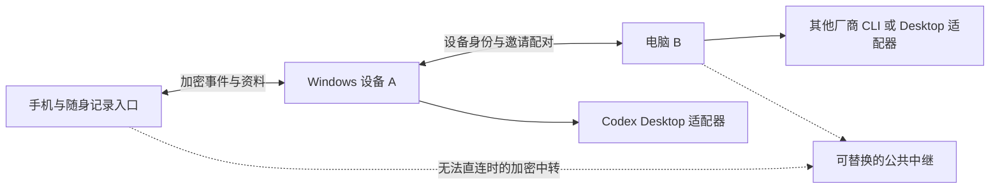

# 伴随完整技术方案

版本提示：本文保留原始规划与历史边界。当前 0.2 的实现范围见 [V2 实现说明](V2实现说明.md)，实际通过与待验收项目见 [验证记录](验证记录.md)。
0.1 采用本地优先的薄壳：真实模型工作交给厂商客户端，资料与协调状态保存在用户设备。完整目标是多设备、多执行环境协作；当前实现先用一台 Windows 作为协调点，避免先建设一套模型平台。

## 当前实现结构

工作台只监听 `127.0.0.1:47471`。手机入口为 `47472` 的独立 HTTPS，只接受配对和资料登记；手机凭证无法操作工作台或调度模型。飞书使用原有长连接，不需要公网回调服务器。

程序安装于 `%LOCALAPPDATA%\CompanionMVP\app`，数据位于其相邻的 `data`。桥接原来的消息账本、绑定与密钥继续留在原桥接目录。应用和数据分开更新。

## 对象与关系

| 对象 | 职责 | 0.1 存储与关键字段 |
|---|---|---|
| 事项 Task | 用户的目标、当前执行与交付 | `tasks`；id、threadId、parentId、role、status、captureIds、private、lastJobId |
| 执行 Job | 一次发送意图与投递结果 | 原桥接 `jobs`；scope、marker、threadId、turnId、status、outcome |
| 对话消息 | 用户请求与公开答复 | `messages` 与按需读取的原生快照；不展示推理和工具内部输出 |
| 资料 Capture | 主动留下的原始片段 | `captures` 与图片文件；来源、登记时间、文字、链接、coverage、附件 |
| 记忆 Memory | 明确登记的长期参考 | SQLite kv 中的版本化 JSON；scope、taskId/projectId、enabled、source |
| 成果 Artifact | 某次交付的实际文件内容 | `artifacts` 与按 SHA256 命名的不可变快照 |
| 设备 Device | 允许登记资料的手机 | 设备名、时间与令牌哈希；不保存明文令牌 |
| 请求 Request | 防止重试产生第二份工作 | `requests` 和可复算的稳定 job/task 编号 |

角色不会代替事项隔离上下文。一个角色可以有多个事项；同一事项在工作台、飞书和原生 Codex 中共用 thread。原生导入与本地绑定同时发生时，按 thread 唯一约束合并，保留消息、成果、子事项与别名。

## 请求、执行与恢复

入口为发送分配稳定 requestId。请求内容或目标变化时使用新的编号；同一编号被复用到其他内容会被拒绝。资料登记也以设备、记录 ID 和内容哈希核对，数据库提交前已写入的相同图片可以在重试中复用。

执行复用原 Bridge 的串行 scope、持久化队列、outbox 和“写入状态不明时不盲目重复”的规则。事项绑定后统一到 `thread:<id>`；绑定前用稳定的事项 scope 接住紧随其后的追加，避免一件事被同时创建成两个对话。

桌面读状态使用独立只读适配实例，避免页面刷新中断桥接正在进行的写操作。列表按需导入最近记录，旧历史用游标分页；打开事项读取近期公开消息。原生历史缺少用户消息时，用已保存的本地请求按 turn 与 marker 合并，保留请求但不显示工具输出。

状态根据最新有效工作和未解决意图派生。旧历史重放不能覆盖新的暂停意图；旧 final 不能把新队列或 uncertain 标成完成。专业最终交付单独保存，进度不能覆盖结果。没有同轮最终正文时保持同步状态。

跨入口的最终回信按 chat 与 topic 合并目的地；已结束的追加可以在恢复时重建回复兴趣。只回本次来源，之后的工作台私聊不沿用旧飞书订阅。

## 秘书和专业分工

秘书与专业方向都继续使用已登录的 Codex Desktop。0.1 为四种工作配置，不创建独立模型账户，不建设自己的 agent 推理循环。秘书可直接解决，也可通过本地能力接口创建专业子事项。

委派是异步的。秘书提交子目标后结束当前回合，子工作完成后协调层将确切结果接回秘书，避免父工作占满所有执行位置。等待父事项获得协调余量，专业子事项优先出队；最多一层、四个子事项。对子事项的再次补充产生新的交付代次，秘书会再次接回。

任务能力凭证仅能读自身与自身子事项、访问本次允许的资料和委派范围。它不是操作系统沙箱：运行在同一 Windows 账户下的 Codex 仍拥有原来环境赋予的文件和工具能力。组消息不能因委派升级为私人资料访问。

## 资料与分层记忆

完整目标分为六层：原始来源片段、事项经过与决策、领域或项目事实、用户共同偏好、当前请求的临时上下文、经过验证的技能与方法。每层使用不同保留期、检索方式和确认规则。

0.1 已实现原始片段、事项记录、成果以及显式个人/事项记忆；项目记忆有接口字段。仅相关范围的已启用记忆和明确选入的资料进入初始上下文，秘书还可按需检索。不会把全部历史和全部技能一次塞进模型。

后续记忆候选应保留 `source`、`observedAt`、`scope`、`confidence`、`derivedFrom`、`revision` 与撤回关系。用户说过的事实、模型推断和助手建议必须有类型区别。矛盾先保留证据，明确更正再替代长期规则。

技能增长采用“经验候选—证据审查—试用—发布—评价—退役”的路径。按事项检索少量相关技能，限制同时装载量，记录适用条件与失败案例；技能数量本身不作为聪明程度指标。0.1 继续使用原生 Codex 已有技能，不自动把成功对话升格成技能。

## 手机与本机权限边界

Android 使用原生 Activity、SQLite、Android Keystore 与系统分享协议。API 26 起可安装，目标 API 35。应用只请求联网、网络状态和开机后的同步调度，不读取通知、无障碍内容、微信数据库或其他应用私有目录。

记录和图片先持久化到手机。导入、草稿与提交使用独立编号和事务；文本被清空时不会恢复旧文字。网络同步可在前台触发，后台约十五分钟一次，由系统调度，可能延后。永久内容错误逐条暂停，其他记录继续；断网保留重试。

配对信息包含目标地址、证书叶子 SHA256 与十分钟一次性票据。Android 固定该证书，不使用“信任所有证书”，不跟随重定向。配对后令牌由 Android Keystore 加密，电脑仅留哈希；撤销设备立即拒绝后续登记。

本机工作台用启动片段换取 HttpOnly、SameSite cookie，片段随后从地址栏移除；接口检查 Host、Origin 与操作标记。HTML 成果在独立 iframe 与响应 CSP 中隔离，没有工作台的同源权限和外部网络能力。成果源文件必须位于已确认事项目录内。

## 安装、回滚与数据迁移

安装先等原有工作结束，再停止旧桥接、备份、复制程序和接入 addon。入口兼容性不符时停止；启动失败恢复原 main、config、app 与 settings。备份只留在本机，不进入公开源码包。

原桥接入口保留永久 local fence：即使 addon 加载失败或被撤回，本地虚拟 job 也不能落到真实飞书发送方法。撤回前检查本地未完成工作与未发送 outbox，避免丢回执或错误外发。

导出为普通 ZIP，含 JSON、实际资料图片、已保存公开消息、记忆、任务与成果快照；不包含本客户端的登录密钥、配对凭证或设备令牌。用户原文原样保留，导出不做内容脱敏。原生读取快照当前用于页面衔接，导出只覆盖已持久化的消息账本，不保证收录这些临时快照。当前没有一键导入界面；完整迁移版本应验证格式、显示差异、重建索引并重新配对设备，不能把导入数据当成可执行指令。

## 完整分布式目标

长期角色实体、多机器人身份、角色记忆域和执行环境隔离补充见[角色机器人与隔离方案](角色机器人与隔离方案.md)。多机器人入口与角色数据权限应分别建设，不能用身份分开代替文件和工具的权限隔离。

“用户不自建服务端”应体现为安装客户端、邀请自己的设备、自动同步和选择可用执行节点。跨互联网遇到 NAT、离线设备和移动网络时，通常仍需发现、引导或中继设施；完整方案不能承诺凭空直连所有设备。默认公共设施应可替换，应用数据端到端加密，节点可选择仅在局域网工作。

各设备保存签名事件与版本，资料按内容寻址。任务执行与记忆同步分开：资料可以最终一致，真实副作用需要单一执行租约、幂等键、收据和状态不明后的人工核实。网络分区不能让两个 agent 重复执行同一次外部操作。

记忆修正、归档、撤回和冲突应有可追溯事件。角色身份可迁移，模型厂商会话 ID 由适配器保存；通用任务包与记忆包属于用户，不能将迁移等同于复制厂商内部状态。

0.1 不实现上述分布式协议。现有 Tailscale 只作为可选网络连通方式，不作为已经完成分布式同步的证明。多节点版本先实现设备身份、资料同步和可见冲突，再开放任务接管与跨厂商执行。

## 独立飞书入口的生命周期补充

0.3.2 对独立应用的后台创建、真实配置与发布、分别绑定用户、任务交办、文件交付、工作并回、后台停用和主助理续接完成实测，完整证据见[补测报告](0.3.2用户验收报告.md)。V7 菜单校验失败时只回退最小机器人启用；继续消息事件、卡片回调和发布，不伪造菜单可用状态。

交接的回信来源迁移和单个任务所有权变化在同一事务完成，并审计旧来源。仅接受原应用与原用户匹配的私人任务；新目标使用主应用自己的 open_id，新建消息并清理旧平台资源编号。已有附件投递不改写目标，先等包括尚未到重试时间、本地文件到转发的两个阶段以及已持久化操作全部排空，再关闭平台入口。

管理接口预检实际租户权限；无授权停在待处理状态，临时错误保留重试。后台操作后的显式人工核验使用独立状态及来源，不等同接口验证。停用占位在首次异步请求前建立，避免并发停用或核验回写互相覆盖；迟到事件不能恢复已停用入口。

## 验证与发布门槛

核对用户完整路径：记录持久化、重试不重复、正确线程接续、真实状态、final 不被进度覆盖、专业回收、资料范围、结果可打开与导出。兼容测试使用真实 Bridge 和隔离数据库，外部 Feishu 与模型调用用假适配器验证零外发。真实部署单独检查 Desktop 只读连接、桥接状态和本机端口。

Android 编译与签名通过不能替代实体手机验收。需补齐实际设备上的系统分享、锁屏后台、厂商省电策略、Wi-Fi 与 Tailscale 连接验证后，再把手机全流程标为实机通过。
