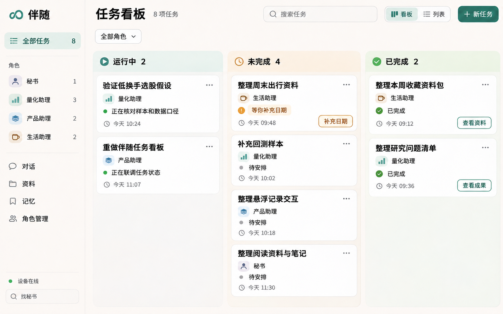
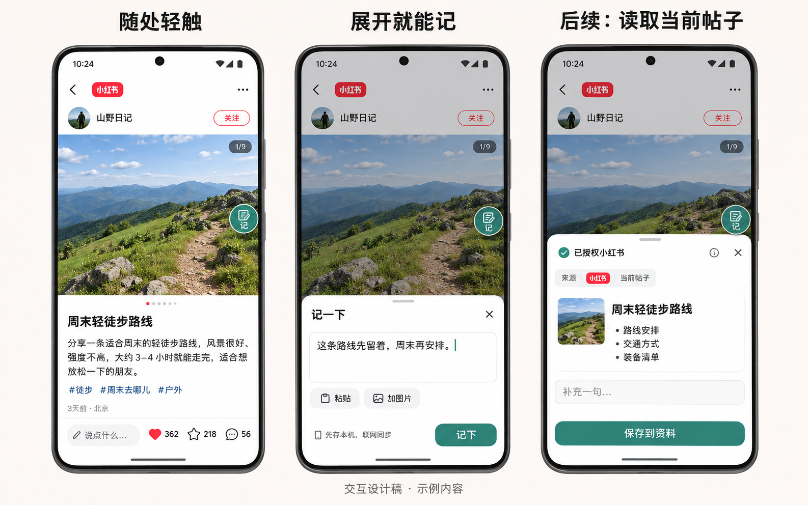

# 第二版任务看板与悬浮记录设计

版本提示：本文保留原始规划与历史边界。当前 0.2 的实现范围见 [V2 实现说明](V2实现说明.md)，实际通过与待验收项目见 [验证记录](验证记录.md)。
2026-11-17。本稿记录新一轮设计要求与 Image Gen 视觉稿。当前运行中的 0.1 功能范围保持原记录；这里的新版布局、悬浮入口和后续内容采集尚未作为运行版交付。

## 任务看板

默认首页是全部任务的大看板，按运行中、未完成、已完成分列，可按角色筛选并切换紧凑列表。任务卡显示目标、负责角色、实际进展与下一步；需要用户处理时给直接操作。点击进入同一事项的进度、对话和成果，返回保留筛选和滚动位置。

执行状态与事项完成状态分别保存。模型空闲不直接代表事情完成；缺少输入、暂停、失败和阻塞仍归未完成。轻记录进入资料库，不因保存一次记录就建立或完成一件任务。

参考 [Botmux Dashboard](https://deepcoldy.github.io/botmux/dashboard.html) 的集中总览、看板/列表与筛选方式，按个人生活和工作收敛界面，保留秘书入口。

## 悬浮记录

APK 的日常主入口改为在其他应用上可唤起的小悬浮球，展开轻量记录面板，支持文字、粘贴和图片。保存后回到原应用，先保存在本机，联网同步。完整主页面承担首次连接、记录历史与入口设置。

第三屏的小红书当前帖子采集属于后续授权能力。按来源分开开启内容获取，保留来源与内容覆盖范围；悬浮显示本身不代表能读取原应用正文。片段、原文与摘要分开保存，授权和获取结果以实际执行为准。

## 秘书与角色

角色管理支持秘书自然提出招募、完成创建、调整分工，以及解雇时把任务、记忆和成果接回。秘书保留全能执行与接管能力。完整规则见[角色机器人与隔离方案](角色机器人与隔离方案.md)。

图像由内置 Image Gen 生成，均为示例数据。初始提示词见 [prompts.json](design-v2/prompts.json)，精修提示词见 [web-refinement-prompt.txt](design-v2/web-refinement-prompt.txt)。
