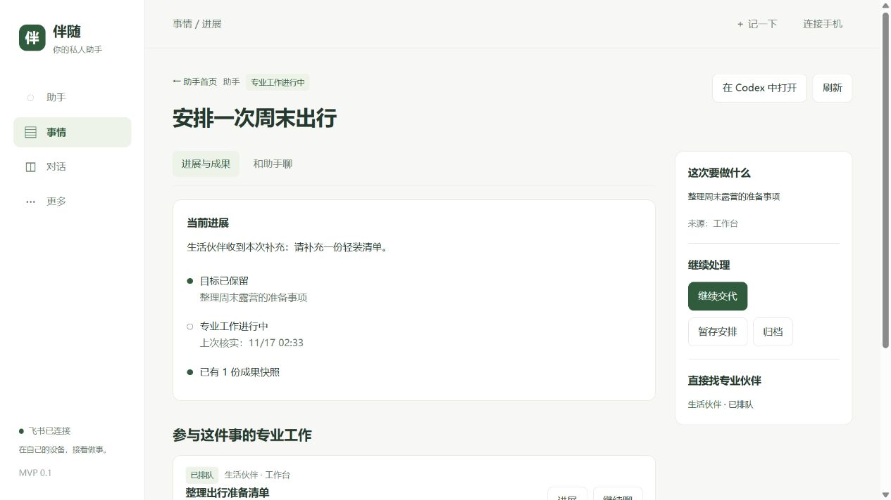

# 伴随 MVP 0.1 验证记录

验证日期：2026-11-17，Windows。此记录区分自动测试、真实连接检查、页面操作和尚未进行的实体设备验证。

## 结果

| 范围 | 结果与证据 |
|---|---|
| 工作台与协调层 | 34 项自动测试通过，无跳过、无失败 |
| 基础 Bridge | 35 项原兼容测试通过；兼容依赖更新后再次通过 |
| 依赖审计 | 工作台、基础桥接锁定依赖均返回 0 个已报告漏洞；桥接的两项旧传递依赖已更新到兼容修复版 |
| Windows 脚本 | 10 个 PowerShell 脚本在 Windows PowerShell 中解析通过；Forms、48px 图标、互斥锁可用 |
| 解压交付包 | Windows 包在独立目录解压，使用包内 Node 22.19.0 再次运行 34 项工作台和 35 项桥接测试，全部通过 |
| Windows 真实安装 | 已安装，原飞书绑定保留，启动任务启用；工作台和手机入口监听正确地址 |
| 真实 Codex 读取 | 已接入 44 个已知事项，读取一个真实对话的 49 条可见消息，无读取错误 |
| 实际连接 | 工作台报告飞书已连接、用户已绑定；本机 HTTPS 健康检查验证证书成功 |
| 运行中的托盘 | 明确 Windows PowerShell 路径后，随桥接启动出现 1 个托盘进程，无启动错误 |
| 实际下载与导出 | 工作台 APK 下载与安装目录文件一致；个人导出是有效 ZIP，未包含本客户端管理密钥 |
| Android 构建 | 原生 SDK 构建成功；v2、v3 签名验证通过；包名、API 与权限清单核对完成 |
| Android 实体设备 | 未安装实机，未验证实际分享面板、后台限制或手机到电脑的真实网络连通 |

## 关键自动检查

包含资料重复登记和中断恢复、旧资料检索、线程绑定前追加、明确事项不跳项目、本地八个入口零飞书外发、跨入口一次回信、重启恢复订阅、个人命令隔离、群子事项不获取私人资料、任务记忆范围、能力接口越权拒绝、一次性配对、设备撤销、HTML 预览隔离和成果快照。

状态检查覆盖旧 final 不覆盖新队列、不确定投递、暂停与等待专业工作，旧 job 重放不倒退最新意图；已完成的本地请求在原生缺用户消息时仍可见。专业结果采用确切 final，后来的进度不能覆盖；对子事项的再次补充会再次接回秘书。

控制命令不创建空任务，配对票据不进入工作台消息与导出。禁用 addon 后永久 local fence 仍保留，撤回前检查未完成本地工作和未发送 outbox。

## 页面操作验收

使用隔离数据库、假 Desktop 与假 Feishu，通过真实浏览器操作首页、记录、事项、聊天、专业伙伴、记忆、配对和成果预览。确认取消记录不提交，首页与专业事项草稿分开保留，追加请求即时可见，暂停刷新后保持暂停，恢复继续原请求，手机默认选本地地址，配对信息跨页面保留。

截图为示例数据，真实生产工作台不预置这些任务：

## 检查边界

测试没有向真实飞书会话发送测试消息，没有创建或推进真实模型对话。真实环境检查使用读取与下载，原桥接处于零活动、零待发送回执状态。模型执行、外部工具授权与飞书消息交付的兼容路径通过原 Bridge 与假外部适配器验证，不能写成真实外发全流程已经验收。

首次安装与启动在本机验证。失败恢复路径已审查并验证补丁启用/禁用和本地外发保护，但没有为了演示而破坏真实配置或执行真实撤回。多电脑 P2P、iOS、统一定时任务管理和自动技能学习不属于已验证的 0.1 能力。
