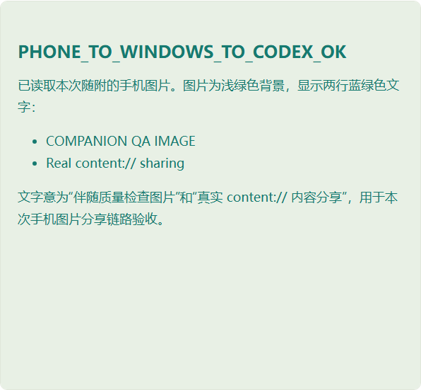
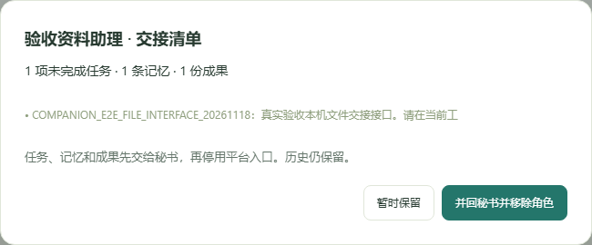

# MVP 0.2 验证记录

2026-11-18，Windows 实际安装环境。这里逐项区分真实链路、隔离回归与尚未完成的外部步骤。旧版记录保留在 [0.1 验证记录](验证记录-0.1.md)。机器路径、账号标识、密钥、配对票据和完整私人日志不进入公开材料。

## 已通过的真实链路

| 案例 | 实际操作与结果 |
|---|---|
| Windows 升级 | 真实安装并启动 0.2，原飞书绑定与数据保留，程序/配置/数据冷备份可用 |
| Android 升级 | 在 Google APIs API 35 x86_64 模拟器安装实际 0.1 APK，登记离线基线；覆盖安装实际 0.2，旧记录保留 |
| 悬浮入口 | 真实系统上层显示权限与前台服务；在另一个应用点图标、输入、保存，返回原应用 |
| 系统分享文字 | 测试阅读应用经真实 Android 分享面板送入链接，APK 登记后同步到 Windows |
| 系统分享图片 | 真实临时 `content://` 读取授权、导入 480×320 PNG；电脑收到一份图片，校验值见 JSON |
| 旋转 | 图片微面板实际旋转后，文字和一张附件保持，没有重复导图 |
| 离线与恢复 | 关闭模拟器网络后登记；电脑查询为 0 条。恢复网络同步后为 1 条 |
| TLS 配对 | 实际 APK 使用一次性票据、证书指纹与 Android Keystore 配对真实 Windows HTTPS 入口 |
| 错误证书 | 故意替换指纹后，实际 APK 拒绝连接，原有配对仍可用 |
| 进程恢复 | 输入未提交草稿、退出并终止应用进程；重新打开可恢复。保存后再次打开不复活旧内容，电脑仅一条 |
| 手机到 Codex | 从实际工作台勾选已同步手机图片、发送请求；真实 Codex Desktop 读出图片两行英文并创建 HTML |
| 成果回传 | 看板读取实际最终答复、生成不可变快照；真实浏览器打开 HTML 预览并下载，校验包含 `PHONE_TO_WINDOWS_TO_CODEX_OK` |
| 模型工作接口 | 真实 Codex 经任务目录内文件交接调用 `state` 和 `propose`；等待状态与招募建议实际入库，没有自动创建机器人 |
| 招募确认 | 实际工作台查看建议并确认，建立长期角色；平台机器人开通仍独立进行 |
| 专业交接 | 同一任务交给该角色；创建独立原生 Codex 对话，保留同一任务编号和手机资料，产生 `EXPERT_HANDOFF_OK` HTML |
| 秘书汇总 | 从专业任务点“请秘书汇总”，回到原秘书对话；汇总实际专业交付，没有重跑专业工作 |
| 解雇与并回 | 实际交接清单确认，任务归秘书；角色记忆带出处合并，重复记忆停用；一份成果与两个历史原生会话保留。该测试角色未绑定平台 app |
| 完成与重开 | 实际浏览器标记完成、重新打开、再次确认完成；同一任务与成果保留。测试任务最终归档 |
| 飞书实际发卡 | 既有机器人真实长连接、用户绑定正常；原生 Card 2.0 测试卡与招募建议已被飞书发送接口接受 |

Android 的源文章和图片内容是合成测试材料；Android 分享面板、权限、APK、SQLite、TLS、Windows 服务与 Codex 执行均实际运行。没有把测试源应用描述成小红书或微信的内部采集接口。

## 隔离回归与故障注入

- **61 项后端测试**：真实 SQLite、文件和 HTTP/TLS 服务；外部 Codex/飞书适配器使用替身，覆盖权限范围、generation 撤销、回执重放、记录恢复、角色交接并发、记忆边界、快照导出和文件工作接口。
- **35 项兼容桥接测试**：绑定、去重、原生正文同步、重连、不确定投递与失败退避。
- **7 项浏览器回归**：真实浏览器与隔离数据库，模型/飞书为替身；覆盖看板筛选、跨轮询分页、专业任务中秘书草稿、只登记不派活、丢响应重试、旧响应不关闭新面板、角色记忆编辑不扩大范围。
- **2 项 Windows 安装器案例**：实际运行安装器，使用独立目录、独立本机端口与替身启动进程。成功案例保留冷备份；注入新版启动失败，核实配置、原进程和资料恢复。未破坏真实用户配置来演示失败。
- JavaScript 23 个模块语法检查通过；Android APK 的 v2/v3 签名检查通过。

## 飞书尚未通过的项目

| 案例 | 当前证据与剩余条件 |
|---|---|
| 固定菜单配置与点击 | 真实 V7 配置调用返回 `99991672`，缺少应用配置权限；需要账号本人确认并发布后点验 |
| 原生按钮回调 | 测试卡已真实发出；尚未完成真实客户端点击与回调返回。隔离回调测试通过不替代此项 |
| 创建第二只独立机器人 | SDK 创建、凭据保护、每 app 绑定和恢复流程已实现；尚未完成账号本人确认与实际绑定 |
| 平台停用 | 内部解雇已实测；平台 app 停用需要相应管理权限，尚未通过真实案例 |

Windows 网络权限提示遮挡了飞书客户端；需要本人收起该提示。飞书授权确认也必须由账号本人完成，不能把“准备了二维码”或“提交发布”写成已经可用。

V7 接口还有应用创建渠道限制。收到对应错误后保留 app 与资料、停止无效自动重试，提示在开发者后台配置或绑定后台创建的应用。用户绑定成功只证明收到了配对文本，不会清除菜单/回调/发布失败。

## 本次真实验收修复的问题

内部 HTTP 工作接口在当前 Codex 权限下触发原生网络确认，现默认改为当前任务目录内的文件交接，沿用相同的角色/任务范围与版本校验；没有关闭原生授权规则。看板现能展示“待桌面确认”。

修复了原生多轮 `newest_first` 消息顺序、秘书缺少专业最新交付、角色工作目录互相覆盖、旧面板响应关闭新草稿、解雇核对期间仍接单，以及分享与悬浮草稿恢复时重复登记的边界。飞书 SDK 原始错误日志已关闭，程序只记录脱敏的状态与错误编号。

## 证据与边界

[结构化结果](verification-v2.json) 包含计数、图片和成果校验值。公开截图只使用合成资料。

实体 Android 手机、厂商省电策略、iOS、多电脑 P2P、持续读取其他应用与自动技能学习未验证，也不属于已交付的 0.2 能力。
